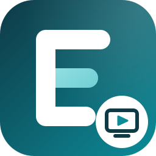
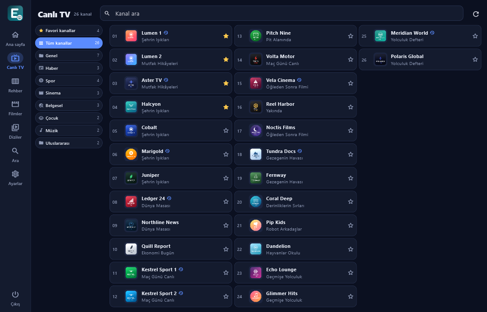
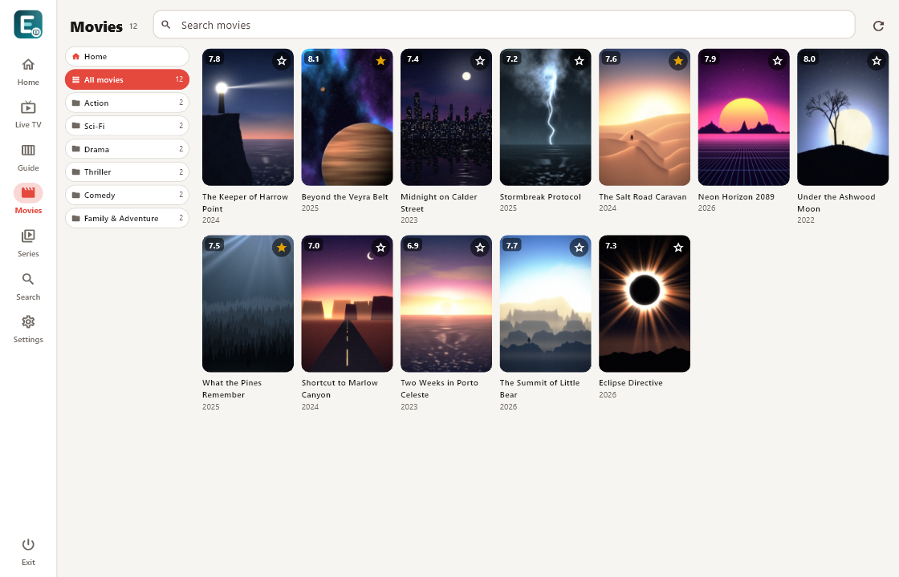
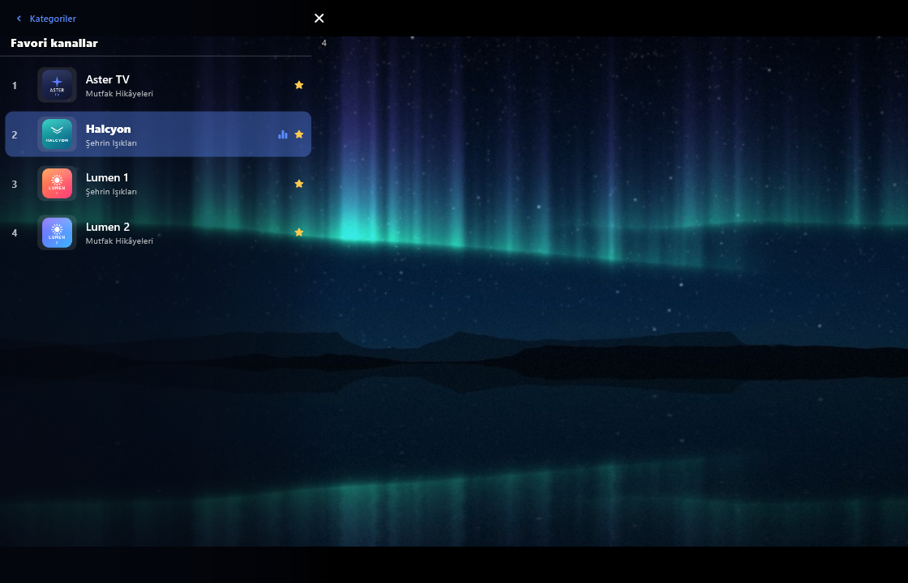

  

<h1 align="center">Erkemoz - IPTV Player</h1>

  <b>Kendi IPTV aboneliğini izlemen için ücretsiz oynatıcı — Windows ve Android</b> 
  <i>Free player for your own IPTV subscription — Windows and Android</i>

  <a href="https://github.com/erkemoz-wq/erkemoz-iptv-player/releases/latest"><b>⬇ Son sürümü indir · Download the latest version</b></a> 
  <code>ErkemozIPTVPlayer_Kurulum_x.y.z.exe</code> · Windows 10 / 11 (64-bit) 
  <code>Erkemoz-IPTV-Player-x.y.z.apk</code> · Android 7+ (telefon, tablet, Android TV / phone, tablet, Android TV) 
  🌐 <a href="https://erkemoz.app/iptv-player/">erkemoz.app</a>

  
  &nbsp;&nbsp;
  
   
  

> **⚖ Yasal uyarı:** Erkemoz - IPTV Player yalnızca bir oynatıcıdır. **Hiçbir kanal, film, dizi ya da yayın listesi içermez ve sağlamaz.** İzlediğin her şey, kendi eklediğin sunucudan gelir. Programı yalnızca izleme hakkına sahip olduğun yasal yayınlar için kullan. Eklenen içerikten ve kullanımdan kullanıcı sorumludur; erkemoz bu içeriklerle hiçbir şekilde ilişkili değildir ve sorumluluk kabul etmez.
>
> **⚖ Legal notice:** Erkemoz - IPTV Player is only a player. **It does not include or provide any channels, movies, series or playlists.** Everything you watch comes from the server you add yourself. Use the app only for legal streams you have the right to watch. The user is solely responsible for the content added and how the app is used; erkemoz is not affiliated with that content in any way and accepts no liability for it.

---

## Türkçe

### Neler yapar
- **Xtream Codes ve M3U** sunucularını ekler; birden çok sunucu tutar, her sunucunun yanında **aboneliğin bitiş tarihi** yazar.
- **Canlı TV, Filmler, Diziler, Rehber (EPG) ve Arama.** Kategoriler solda, kanallar sütun sütun alfabetik; üç kategori görünümü Ayarlar'dan seçilir.
- **Oynatıcı:** yön tuşlarıyla kanal değiştir (üç kez ▼ = üç kanal aşağı), yayın açıkken soldaki panelden kategori ve kanal seç; panel 5 saniye sonra kendiliğinden kapanır.
- Menülerde gezinirken yayın **küçük pencerede sürer**; dönünce kaldığı yerden devam eder.
- Açılışta **son izlediğin kanaldan devam eder** (Ayarlar'dan değiştirilebilir). Filmlerde kaldığın yeri hatırlar, favoriler tutar.
- Windows'ta gerçek tam ekran (F11), Esc ile geri, Android TV'de kumandayla tam kullanım.
- 8 dil, açık ve koyu tema; yeni sürüm çıkınca program haber verir ve tek tıkla günceller.

### Kurulum
- **Windows:** kurulum dosyasını indir ve çalıştır. Windows **"Bilgisayarınız korundu"** (SmartScreen) derse **Ek bilgi → Yine de çalıştır**'a tıkla. Bu uyarı, program henüz ücretli bir kod imzalama sertifikasıyla imzalanmadığı için çıkabilir.
- **Android / Android TV:** APK dosyasını indir ve aç. Telefon "bilinmeyen kaynak" izni isterse bu kurulum için izin ver.

### Gizlilik
Sunucu bilgilerin (adres, kullanıcı adı, şifre) yalnız bu cihazda, işletim sisteminin güvenli kasasında saklanır; erkemoz'a hiçbir şey gönderilmez. Program yalnız senin eklediğin sunucuya ve yeni sürümü denetlemek için GitHub'a bağlanır. Kullanım sayacı yoktur. Ayrıntılar: [Gizlilik Politikası](https://erkemoz.app/privacy/)

### Güvenlik
- **Yalnızca bu sayfadaki resmi sürümü indir.** Her dosyanın SHA-256 parmak izi [sürüm notunda](https://github.com/erkemoz-wq/erkemoz-iptv-player/releases/latest) yazar; program kendini güncellerken indirdiği dosyayı bu parmak iziyle doğrular, tutmazsa kurmaz.
- Açık kaynaklı bileşenler ve lisansları: [`LISANSLAR.txt`](LISANSLAR.txt) ve programda **Ayarlar → Açık kaynak lisansları**. Video oynatma libmpv / FFmpeg (LGPL) ile yapılır.

### İletişim
erkemoz@proton.me · [erkemoz.app](https://erkemoz.app)

---

## English

### What it does
- Adds **Xtream Codes and M3U** servers; keeps several servers and shows **each subscription's expiry date** next to it.
- **Live TV, Movies, Series, TV Guide (EPG) and Search.** Categories on the left, channels in alphabetical columns; three category layouts to choose from in Settings.
- **Player:** change channels with the arrow keys (press ▼ three times = three channels down), pick a category and channel from the side panel while watching; the panel closes by itself after 5 seconds.
- While you browse the menus, the stream **keeps playing in a mini player** and continues where it was when you return.
- At startup it **continues from the last channel you watched** (changeable in Settings). Remembers where you stopped in movies and keeps favorites.
- True fullscreen on Windows (F11), Esc to go back, full remote-control support on Android TV.
- 8 languages, light and dark theme; the app tells you when a new version is out and updates with one click.

### Installation
- **Windows:** download the installer and run it. If Windows says **"Windows protected your PC"** (SmartScreen), click **More info → Run anyway**. This appears because the app is not yet signed with a paid code-signing certificate.
- **Android / Android TV:** download the APK and open it. If your device asks for the "unknown sources" permission, allow it for this installation.

### Privacy
Your server details (address, username, password) are stored only on this device, in the operating system's secure storage; nothing is sent to erkemoz. The app connects only to the server you add and to GitHub to check for new versions. There is no usage counter. Details: [Privacy Policy](https://erkemoz.app/privacy/)

### Security
- **Only download the official release from this page.** Each file's SHA-256 fingerprint is listed in the [release notes](https://github.com/erkemoz-wq/erkemoz-iptv-player/releases/latest); when the app updates itself it checks the downloaded file against this fingerprint and won't install it if it doesn't match.
- Open-source components and their licenses: [`LISANSLAR.txt`](LISANSLAR.txt) and in the app under **Settings → Open-source licenses**. Video playback uses libmpv / FFmpeg (LGPL).

### Contact
erkemoz@proton.me · [erkemoz.app](https://erkemoz.app)

---

© erkemoz · erkemoz.app

